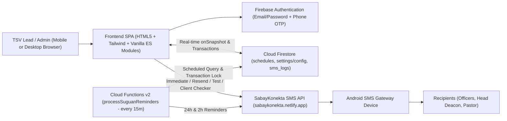
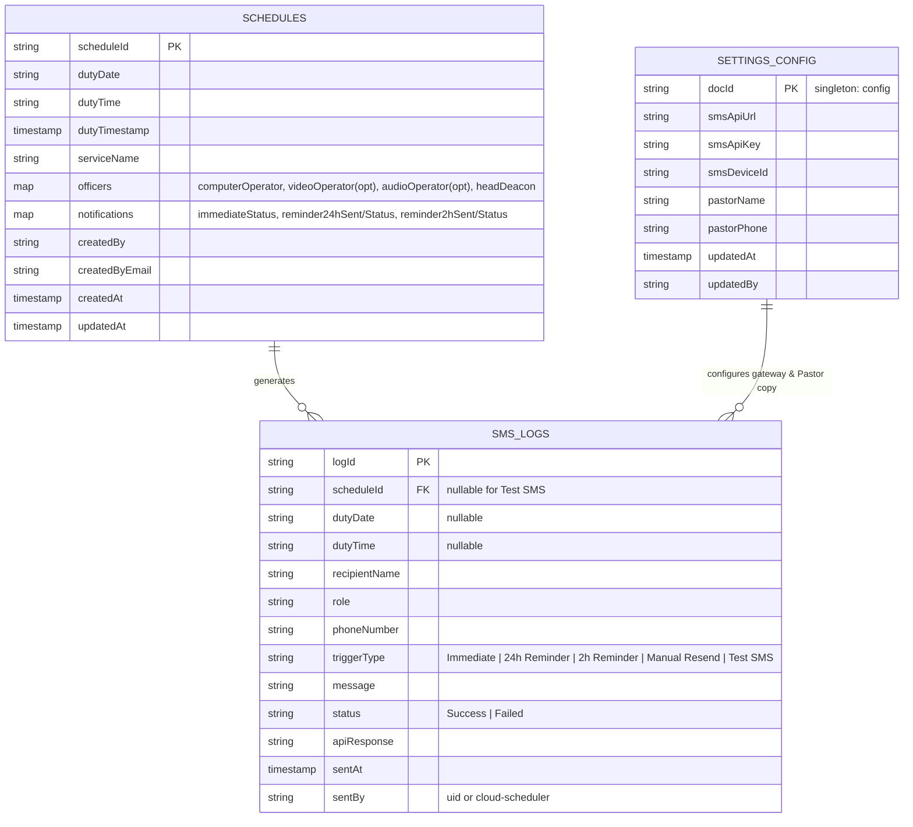
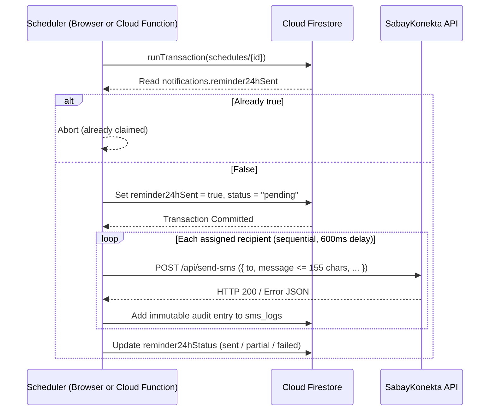

# Architecture Requirements Document (ARD)
## TSV Suguan Monitoring and Reminder System

| Field | Details |
| :--- | :--- |
| **System Name** | TSV Suguan Monitoring and Reminder System |
| **Firebase Project** | `tsvsuguan` |
| **Document Version** | 1.0 |
| **Date** | November 19, 2026 |

---

## 1. System Architecture Overview

The application uses a **Serverless Real-Time Web Architecture** backed by **Firebase** (Authentication, Cloud Firestore, Cloud Functions v2, Hosting) and integrated with the external **SabayKonekta Android SMS Gateway** (`https://sabaykonekta.netlify.app`).



---

## 2. Technology Stack

| Layer | Technology | Rationale |
| :--- | :--- | :--- |
| **Frontend UI** | HTML5, Tailwind CSS (CDN), Custom CSS (`css/styles.css`) | Zero build step, fast load times, responsive mobile-first encoding, native `<dialog>`, `:user-invalid`, `@container` tables, and `popover="manual"` toasts. |
| **Frontend Logic** | Vanilla JavaScript (ES Modules, Firebase Web SDK `v13.4.0`) | Clean modular separation without framework overhead. |
| **Authentication** | Firebase Authentication (Email/Password + Phone OTP w/ reCAPTCHA) | Managed identity, password reset, and SMS OTP with zero backend auth boilerplate. |
| **Database** | Cloud Firestore (NoSQL, `asia-southeast1`) | Real-time UI sync (`onSnapshot`) and ACID transactions (`runTransaction`) for duplicate-free reminder locking. |
| **Background Scheduler** | Client-side 60s timer (`js/scheduler.js`) + Firebase Cloud Functions v2 (`functions/index.js`, Node 20) | Immediate responsiveness when dashboard is open + unattended 24/7 execution when closed. |
| **SMS Gateway** | SabayKonekta REST API (`POST /api/send-sms`) | Dispatches GSM-7 SMS via paired Android Gateway device. |

---

## 3. Codebase Module Architecture

| Module | File Path | Responsibility |
| :--- | :--- | :--- |
| **Entry Shell** | `index.html` | Semantic views (`auth-view`, `dashboard-view`), native `<dialog>` modals, accessible toast region. |
| **Styles** | `css/styles.css` | `:user-invalid` validation feedback, `dialog:modal` scroll containment, `@container` responsive stacked table, popover toast transitions. |
| **Firebase Init** | `js/firebase-config.js` | Initializes Firebase App, Auth, and Firestore (`v13.4.0`) and exports SDK primitives. |
| **Auth Controller** | `js/auth.js` | Email/Password login, password reset, Phone OTP flow (`RecaptchaVerifier`), Logout, `onAuthStateChanged` route guard. |
| **Dashboard Controller** | `js/app.js` | Firestore `onSnapshot` listeners, schedule CRUD, filter/search state, Settings & Test SMS forms, modal handlers. |
| **SMS Service** | `js/sms-service.js` | Recipient resolution, compact 1-segment GSM-7 message builder, SabayKonekta HTTP client, sequential `600ms` dispatcher, `sms_logs` writer. |
| **Client Scheduler** | `js/scheduler.js` | 60-second reminder evaluator using Firestore transactions to atomically claim `reminder24hSent` / `reminder2hSent`. |
| **Phone Utilities** | `js/phone-utils.js` | Philippine mobile regex validation, E.164 (`+639XXXXXXXXX`) & local (`09XXXXXXXXX`) normalization, display formatting. |
| **UI Helpers** | `js/ui-helpers.js` | Asia/Manila date/time formatting, HTML escaping, ARIA validation sync, `<dialog>` fallback, `popover="manual"` toast manager. |
| **Cloud Scheduler** | `functions/index.js` | `onSchedule('every 15 minutes', { timeZone: 'Asia/Manila' })` server-side reminder processor using Firebase Admin SDK. |
| **Security Rules** | `firestore.rules` | Non-anonymous auth guard, strict key allowlists, schema/type/length validation, immutable fields, default-deny. |

---

## 4. Data Architecture (Cloud Firestore)



### Indexing Strategy (`firestore.indexes.json`)
- `schedules`: Single-field ascending index on `dutyTimestamp` (powers chronological listing and Cloud Function range queries `now < dutyTimestamp <= now + 24h15m`).
- `sms_logs`: Single-field descending index on `sentAt` (powers latest-250 audit log stream).

---

## 5. Automated SMS Dispatch & Concurrency Flow

To prevent duplicate SMS alerts when multiple browser tabs and the Cloud Function evaluate the same upcoming schedule, both schedulers use an **Optimistic Transaction Lock** before making any external HTTP call:



---

## 6. External Integration Specification (SabayKonekta SMS API)

- **Endpoint**: `POST https://sabaykonekta.netlify.app/api/send-sms` (configurable via `settings/config`).
- **Headers**:
  - `Content-Type: application/json`
  - `Authorization: Bearer <smsApiKey>`
  - `x-api-key: <smsApiKey>`
- **Request Payload**:
  ```json
  {
    "to": "+639XXXXXXXXX",
    "message": "[TSV SUGUAN] Nov 22 6:00AM\nRole: Computer Op\nComp:Juan Dela Cruz\nHD:Bro. Roberto\nSalamat po!",
    "api_key": "<smsApiKey>",
    "device_id": "<optional>",
    "sender_id": "<optional>"
  }
  ```
- **Gateway Constraints Handled**:
  - **Single-Segment Limit**: All messages are strictly capped at **≤ 155 GSM-7 ASCII characters** (`segments: 1`) so the Android Gateway's `SmsManager` dispatches reliably without dropping multipart messages.
  - **Rate Limiting**: Recipients are dispatched sequentially with a `600ms` delay and a `15s` request timeout (`AbortController`).

---

## 7. Security Architecture

1. **Authentication Boundary**: Only provisioned, non-anonymous Firebase Auth accounts (`sign_in_provider != 'anonymous'`) pass `isTsvAdmin()`.
2. **Strict Schema Enforcement (`firestore.rules`)**:
   - Exact key allowlists (`hasOnly` + `hasAll`) on every document and nested map (`officers`, `notifications`).
   - String length bounds on all fields to prevent document bloat/DoS.
   - `createdBy` and `createdAt` locked as immutable on `schedules` updates.
   - `settings/config` restricted to singleton `get`/`create`/`update` (`list` and `delete` denied).
   - `sms_logs` enforced as **append-only** (`update` and `delete` denied from clients).
   - Explicit catch-all default deny (`match /{document=**} { allow read, write: if false; }`).
3. **XSS Mitigation**: All dynamic data rendered into HTML strings is escaped via `escapeHtml()`; API responses and SMS bodies in modals are injected via `textContent`.

---

## 8. Deployment & Operations

| Component | Deployment Command | Notes |
| :--- | :--- | :--- |
| **Firestore Rules & Indexes** | `firebase deploy --only firestore:rules,firestore:indexes` | Or paste `firestore.rules` in Firebase Console. |
| **Web Frontend** | `firebase deploy --only hosting` | Static hosting from workspace root (`firebase.json`). |
| **Cloud Scheduler Function** | `cd functions && npm install && cd .. && firebase deploy --only functions` | Requires Firebase Blaze plan for outbound HTTP & Cloud Scheduler. |

